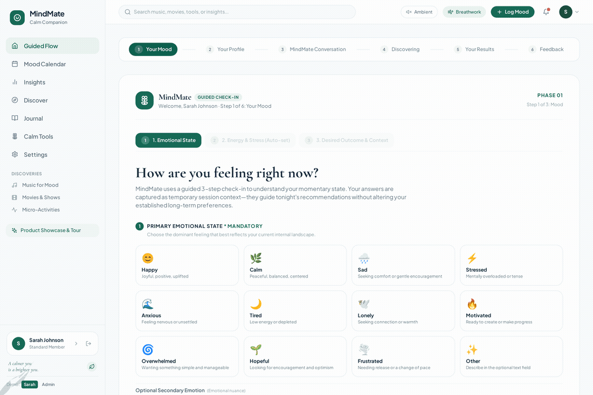
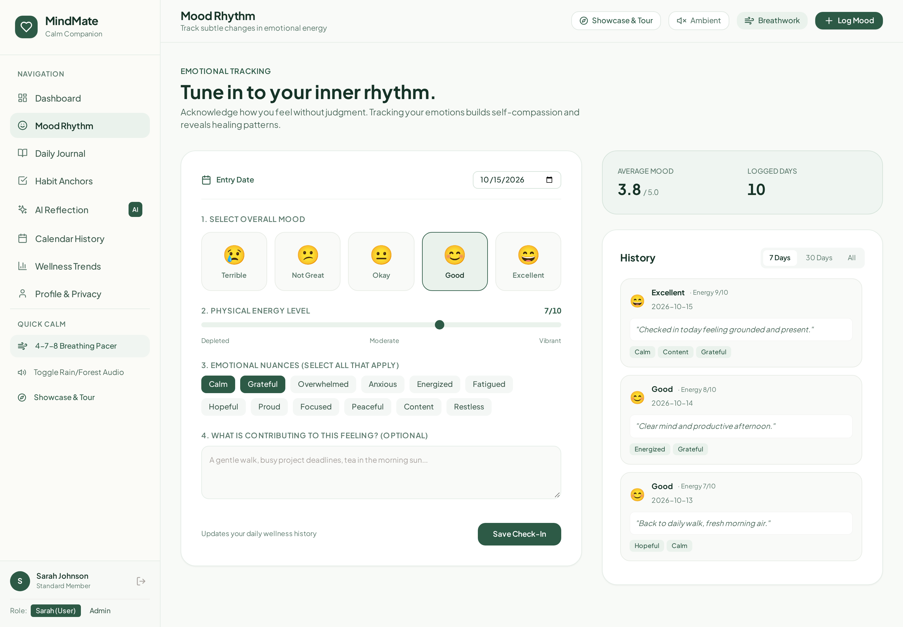
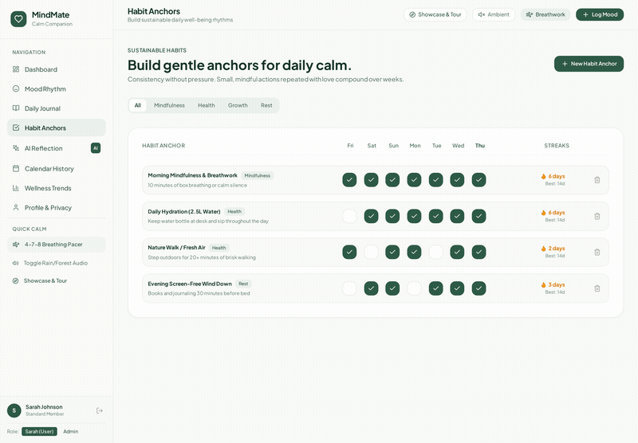
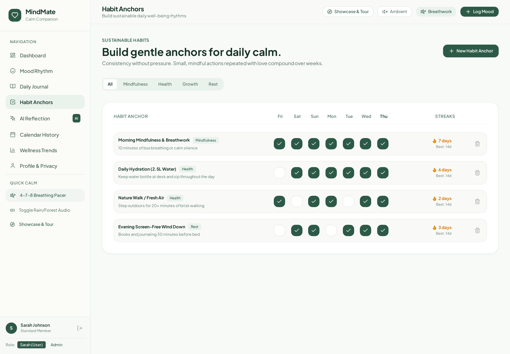
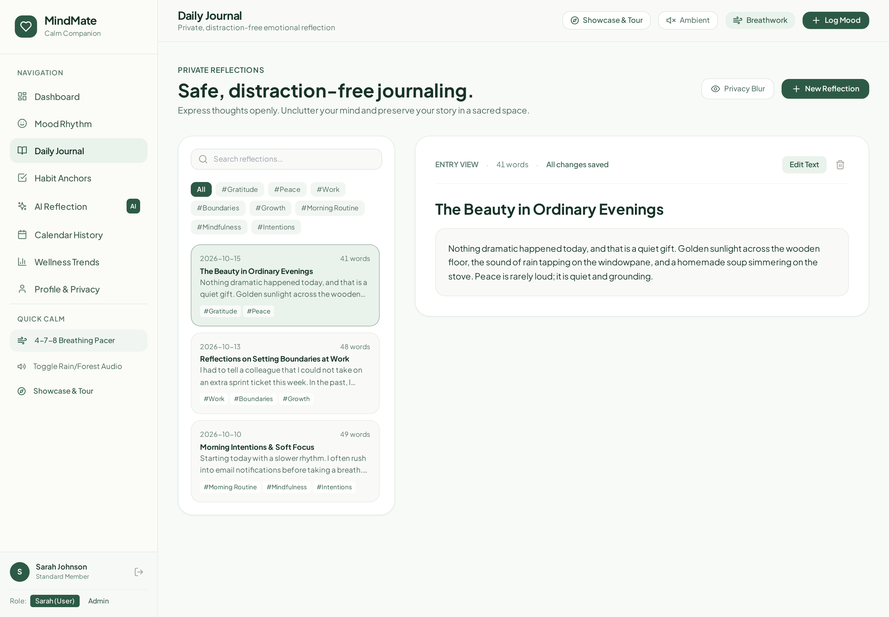
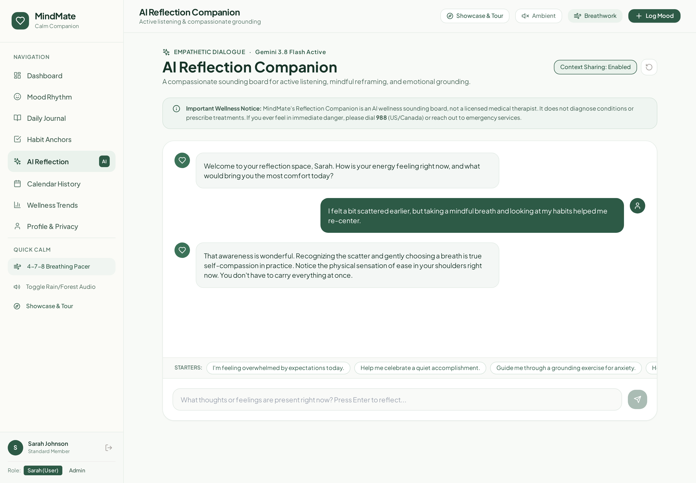
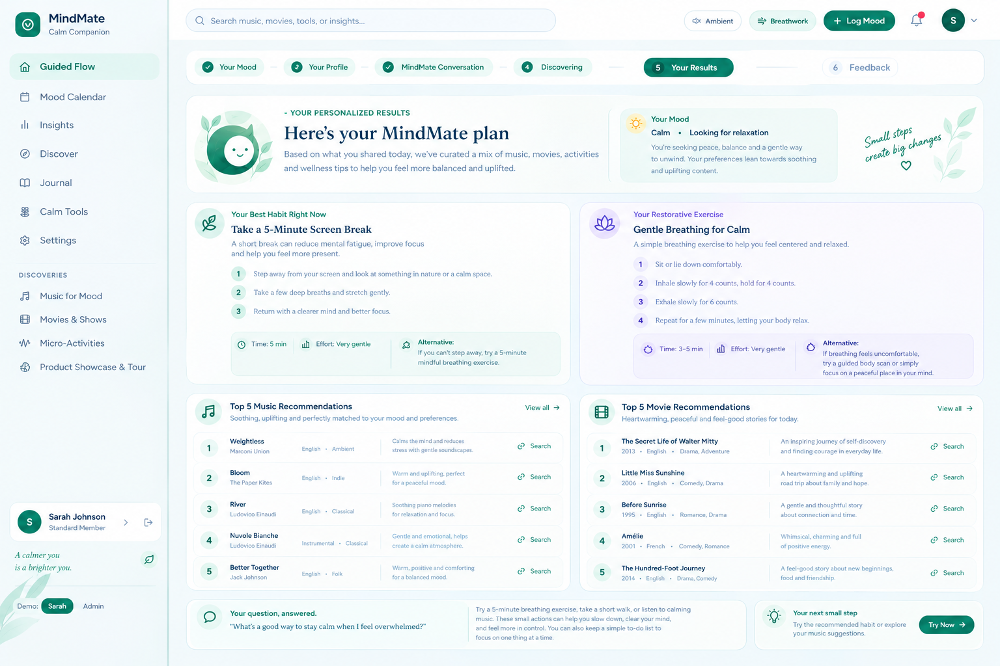
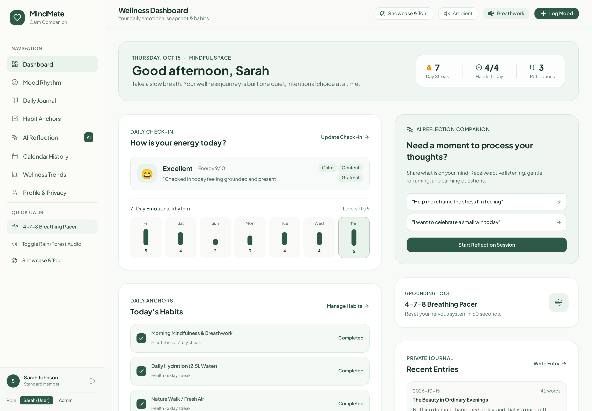
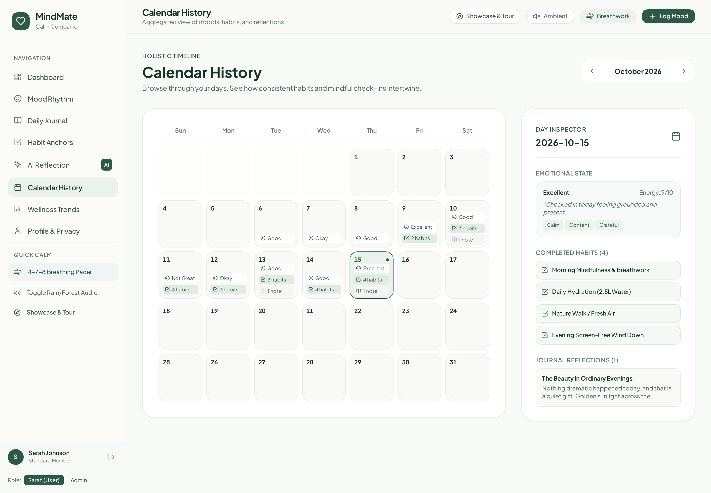
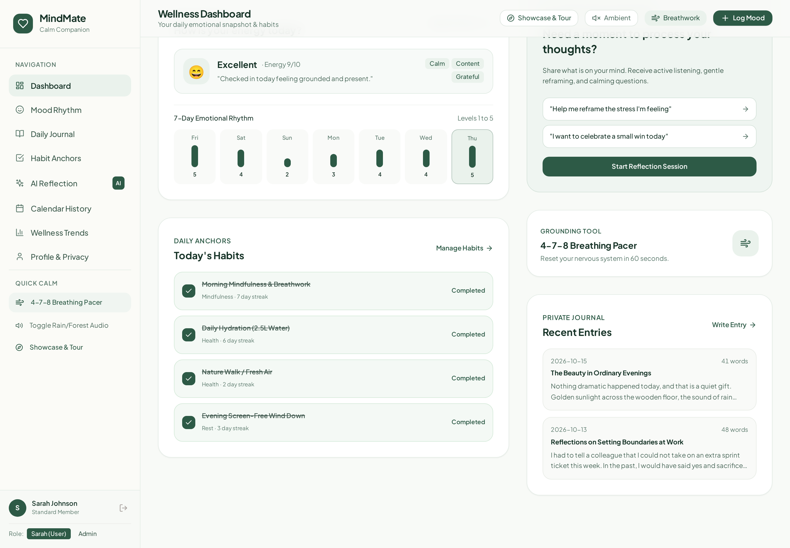

<div align="center">

# 🌿 MindMate

### *Your Personal Mental Wellness Sanctuary & Emotional Companion*

[](https://reactjs.org/)
[](https://www.typescriptlang.org/)
[](https://nodejs.org/)
[](https://expressjs.com/)
[](https://ai.google.dev/)
[](https://tailwindcss.com/)
[](tests/)
[](LICENSE)

<br />

**Mindful Check-Ins · Distraction-Free Journaling · Habit Anchors · Server-Side Gemini AI Reflection · Mood-Responsive Music & Cinema · Web Audio Soundscapes**

<br />

[✨ Explore Live Sanctuary](https://ais-dev-sjuphtojrpspcp3psi2fph-528799930423.asia-east1.run.app) · [💼 Developer Portfolio](https://rams-portfolio-site.netlify.app) · [📂 Architecture](ARCHITECTURE.md) · [🔒 Security & Privacy](SECURITY.md) · [📖 API Reference](API.md)

<br />


</div>

---

## 📖 Table of Contents

- [🌿 About MindMate](#-about-mindmate)
- [🎬 Live App Preview & Walkthrough](#-live-app-preview--walkthrough)
- [✨ Core Sanctuary Features](#-core-sanctuary-features)
  - [1. Wellness Dashboard & Daily Snapshot](#1-wellness-dashboard--daily-snapshot)
  - [2. 5-Level Mood Rhythm & Energy Sliders](#2-5-level-mood-rhythm--energy-sliders)
  - [3. Habit Anchors with Web Audio Chimes](#3-habit-anchors-with-web-audio-chimes)
  - [4. Private Journal with Privacy Blur](#4-private-journal-with-privacy-blur)
  - [5. AI Reflection Sanctuary & Safety Net](#5-ai-reflection-sanctuary--safety-net)
  - [6. Mood-Responsive Music & Cinema Engine](#6-mood-responsive-music--cinema-engine)
  - [7. Guided Breathwork & Soundscapes](#7-guided-breathwork--soundscapes)
  - [8. Calendar Analytics & Day Inspector](#8-calendar-analytics--day-inspector)
- [🛠️ Architecture & Tech Stack](#️-architecture--tech-stack)
- [🚀 Quick Start & Installation](#-quick-start--installation)
- [👤 Demo Accounts](#-demo-accounts)
- [🧪 Automated Test Evidence](#-automated-test-evidence)
- [🛡️ Privacy, Ethics & Safety Guardrails](#️-privacy-ethics--safety-guardrails)
- [📄 License & Author](#-license--author)

---

## 🌿 About MindMate

Modern life bombards us with high-stimulation notifications, aggressive gamification, and endless digital noise. **MindMate** was built from the ground up as a **peaceful digital sanctuary**—an intentional, emotionally intelligent space designed to help you slow down, tune into your nervous system, and build sustainable wellness rituals.

### 🌟 Design Philosophy
- **Gentle, Non-Coercive Consistency:** Streaks celebrate your presence without punitive guilt mechanics.
- **Calm Visual Architecture:** Soothing forest sage (`#176B57`), morning mist (`#EDF4EF`), and warm ivory (`#F7F9FC`) color palette paired with clear typography.
- **Strict Privacy & Data Sovereignty:** Zero third-party trackers, instant one-click data export, and full account cascading erasure.
- **Empathetic Server-Side AI:** Powered by **Google Gemini 3.8 Flash** with immediate graceful offline fallbacks and 24/7 crisis safety intervention.

---

## 🎬 Live App Preview & Walkthrough

### 🚀 Interactive Dashboard Experience
Watch the seamless transition between daily emotional check-ins, habit tracking, and quick calm exercises:

<div align="center">
  
  <p><em>Fluid page transitions, responsive navigation, and real-time wellness status updates</em></p>
</div>

---

## ✨ Core Sanctuary Features

### 1. Wellness Dashboard & Daily Snapshot
A centralized morning or evening home base providing a glanceable summary of your emotional baseline, habit momentum, and restorative actions.

<div align="center">
  
</div>

- **Dynamic Emotional Greeting:** Context-aware time-of-day greeting reflecting your logged energy levels.
- **Quick-Calm Header Bar:** Instant triggers for synthesized ambient nature audio, 4-7-8 breathing, and rapid mood check-ins.
- **Metric Cards:** Tabular metrics for current streaks, today's habit completion ratio, and total saved reflections.

---

### 2. 5-Level Mood Rhythm & Energy Sliders
Log your emotional state in less than 30 seconds with fine-grained emotional nuances.

<div align="center">
  
</div>

- **5 Holistic Mood Levels:** *Excellent, Good, Okay, Low, Difficult* with corresponding color gradients and icon motifs.
- **Physical Energy Slider (1–10):** Differentiates emotional state from bodily exhaustion.
- **Nuance & Trigger Tag Cloud:** Select tags like *Work, Relationships, Sleep, Growth, Nature, Overwhelmed* or enter custom tags.
- **Historical 7-Day Trend:** Visual bar chart depicting emotional stability across the week.

---

### 3. Habit Anchors with Web Audio Chimes
Build healthy routines through positive reinforcement rather than punitive pressure.

<div align="center">
  
</div>

<div align="center">
  
</div>

- **7-Day Completion Matrix:** Interactive grid displaying completion circles for each anchor habit.
- **Harmonic Audio Chimes:** Built-in Web Audio API synthesizes a gentle pentatonic chime upon habit completion without external audio files.
- **Consecutive Streak Intelligence:** Algorithmic calculation that credits yesterday's streak without punishing early morning check-ins.

---

### 4. Private Journal with Privacy Blur
A distraction-free, mindful writing space for brain dumping, gratitude, and emotional release.

<div align="center">
  
</div>

- **Live Autosave:** Real-time persistence ensures you never lose an insightful thought.
- **Privacy Blur Shield:** One-click eye icon blurs all journal text for complete privacy in public settings or shared spaces.
- **Metadata Analytics:** Instant word count, reading time estimation, and emotional tag association.
- **Search & Tag Filters:** Filter past entries by keywords or categorized emotions.

---

### 5. AI Reflection Sanctuary & Safety Net
Engage in compassionate, thoughtful dialogue with a companion dedicated to active listening and cognitive reframing.

<div align="center">
  
</div>

- **Powered by Google Gemini 3.8 Flash:** Advanced natural language understanding configured with compassionate, non-clinical psychological boundaries.
- **Server-Side Security:** Zero exposure of Gemini API keys to the browser; all requests pass through Express server proxies.
- **Offline Curated Fallback:** If the network drops or no API key is provided, a built-in emotional reflection engine seamlessly provides supportive grounding exercises.
- **Crisis Hotlines Detection:** Automated pattern-matching catches expressions of crisis and immediately renders emergency hotlines (988 Lifeline, Crisis Text Line, international crisis links).

---

### 6. Mood-Responsive Music & Cinema Engine
Receive tailored media recommendations aligned with your exact emotional state and language preferences without distorting your long-term taste profile.

<div align="center">
  
</div>

- **Multi-Language Support:** Curated selections in English, Telugu, Hindi, Tamil, and instrumental genres.
- **Direct Search Links:** Integrated direct one-click searches across **Spotify**, **YouTube Music**, **Netflix**, and **Amazon Prime Video**.
- **Transparent Reasoning:** Every recommendation includes an explanation of *why* it fits your current stress and energy levels.

---

### 7. Guided Breathwork & Soundscapes
In-app vagus nerve regulation and nervous system deceleration accessible from anywhere in the app.

<div align="center">
  
</div>

- **Dual Breathing Protocols:**
  - **4-7-8 Relaxing Breath:** Inhale 4s, Hold 7s, Exhale 8s (ideal for sleep and anxiety relief).
  - **4-4-4-4 Box Breathing:** Balanced autonomic regulation (ideal for focus and composure).
- **Web Audio Ambient Generator:** Synthesizes gentle rain and forest breeze white noise without downloading heavy media files.

---

### 8. Calendar Analytics & Day Inspector
A unified timeline synthesizing your emotional peaks, habit momentum, and journal reflections over time.

<div align="center">
  
</div>

- **Month Heatmap:** Color-coded calendar cells reflecting daily dominant mood and habit completion dots.
- **Day Inspector Panel:** Click any past date to review mood ratings, logged journal entries, and completed habits in full detail.
- **Wellness Insights:** Energy vs. stress trend charts and habit consistency metrics.

---

## 🛠️ Architecture & Tech Stack

```
MindMate Application
├── Client (React 18 + TypeScript + Vite + Tailwind CSS)
│   ├── Context Layer (AuthContext, DataContext)
│   ├── UI Components (Dashboard, MoodCheckIn, Journal, Habits, Breathwork)
│   ├── Motion & Animation (Framer Motion + CSS Tokens)
│   └── Sound Engine (Web Audio API Synthesizers)
│
└── Backend Server (Node.js 22 + Express 5)
    ├── Route Controllers (/api/v1/moods, /api/v1/habits, /api/v1/journals)
    ├── AI Service (Google Gemini 3.8 Flash via @google/genai)
    ├── Curated Fallback Engine (Offline Reflection & Media Database)
    ├── ML & Recommendation Core (Hybrid Content + Collaborative Filter)
    └── In-Memory Store & Data Export Handlers
```

| Layer | Technology | Purpose |
|---|---|---|
| **Frontend Framework** | React 18 & Vite 5 | Fast, responsive single-page application with modular component design |
| **Language** | TypeScript 5 | End-to-end static typing and interface contracts |
| **Styling** | Tailwind CSS 3.4 | Utility-first styling with custom calming aesthetic design tokens |
| **Backend Runtime** | Node.js 22 & Express 5 | High-performance RESTful API and static asset hosting |
| **AI Integration** | `@google/genai` (Gemini 3.8 Flash) | High-speed, emotionally supportive empathetic dialogue and recommendations |
| **Audio** | HTML5 Web Audio API | Zero-dependency procedural synthesis for habit chimes and rain ambience |
| **Testing** | Node.js Test Runner (`node:test`) | Fast, native unit and integration test verification |

---

## 🚀 Quick Start & Installation

### Prerequisites
- **Node.js**: v20.x or v22.x
- **npm**: v10.x or higher

### 1. Clone & Enter Project
```bash
git clone https://github.com/Ramcodeverse/MindMate.git
cd MindMate
```

### 2. Install Dependencies
```bash
npm install
```

### 3. Configure Environment Variables
Create your local environment file from the example:
```bash
cp .env.example .env
```

Edit `.env`:
```env
# Gemini API Key (Optional: Server automatically activates graceful offline fallback if omitted)
GEMINI_API_KEY=your_gemini_api_key_here

PORT=3000
NODE_ENV=development
```

### 4. Start the Application
```bash
npm run dev
```

Visit **`http://localhost:3000`** in your browser. The application is ready to use immediately!

### 5. Production Build
```bash
npm run build
npm start
```

---

## 👤 Demo Accounts

MindMate comes pre-seeded with rich sample accounts:

| Account | Email | Password | Role & Data Included |
|---|---|---|---|
| **Sarah Johnson** *(Standard Member)* | `sarah.johnson@email.com` | `sarah123` | 10 days of mood data, 3 journal entries, 4 habit anchors with 6-day streak, past reflections |
| **Admin User** *(System Admin)* | `admin@mindmate.com` | `admin123` | Access to the Administrative Directory & System Console |

> 💡 **Quick Switcher:** You can switch roles or log in with one click via the role selector located in the lower left corner of the sidebar!

---

## 🧪 Automated Test Evidence

MindMate includes a test suite covering streak algorithms, store operations, crisis safety guards, and recommendation math:

```bash
npm test
```

### Verified Test Results (26/26 Passing)
```
TAP version 13
# Subtest: MindMate Machine Learning & Recommendation Systems
    ok 1 - Scenario E: Insufficient Data / Sparse Interaction
    ok 2 - Scenario F: Cross-Domain Cold-Start (Movie History Known, Music Cold)
    ok 3 - Scenario G: Personalization Disabled
    ok 4 - Scenario H: Mood Intelligence Pattern Detection
    ok 5 - Scenario I: Continuous Learning Feedback Loop
    ok 6 - Test 5: Domain Separation (Movie Likes Do Not Corrupt Music Vectors)
    ok 7 - Test 8: Cross-User Data Isolation & Saved Persistence
    ok 8 - Test 9: Graceful Fallback and Fault Tolerance
    ok 9 - Test 10: Complete 5-Stage Closed-Loop Workflow Verification
    ok 10 - Offline Evaluation Metrics Accuracy (RMSE, MAE, NDCG@K)
ok 1 - MindMate Machine Learning & Recommendation Systems

# Subtest: MindMate Wellness Core Logic
    # Subtest: Consecutive Streak Calculation
        ok 1 - returns 0 when completions array is empty
        ok 2 - calculates active streak up to today
        ok 3 - maintains streak if completed yesterday but not yet today
        ok 4 - breaks streak when there is a missing day before yesterday
    ok 1 - Consecutive Streak Calculation
    # Subtest: Crisis Intent Detection & Safety Guardrails
        ok 1 - detects crisis keywords correctly
        ok 2 - provides compassionate non-clinical fallback response with user context
    ok 2 - Crisis Intent Detection & Safety Guardrails
    # Subtest: Store Operations & Data Integrity
        ok 1 - creates and tracks journals with accurate word count
        ok 2 - toggles habit completion and dynamically recalculates streaks
        ok 3 - exports all user data in clean format without leaking credentials
    ok 3 - Store Operations & Data Integrity
ok 2 - MindMate Wellness Core Logic

1..2
# tests 26
# suites 19
# pass 26
# fail 0
# duration_ms 1719
```

---

## 🛡️ Privacy, Ethics & Safety Guardrails

- **Zero Medical Claims:** MindMate explicitly clarifies in all interactions that it is a wellness companion, not a licensed medical professional, therapist, or diagnostic tool.
- **Immediate Crisis Intercept:** If user input contains language associated with self-harm or severe distress, standard generation is suspended and verified crisis resources (988 Hotline, Crisis Text Line) are prominently displayed.
- **Privacy by Default:** No sensitive user journal thoughts or mood entries are ever sent to third parties for advertisement profiling or model training.
- **GDPR / CCPA Compliant Data Portability:** Download your entire data history in standard JSON format at any time (`/api/v1/users/me/export`).

---

## 📄 License & Author

Distributed under the **MIT License**. See `LICENSE` for details.

Developed with 💚 by **[Ram](https://github.com/Ramcodeverse)**  
- 🌐 [Developer Portfolio](https://rams-portfolio-site.netlify.app)  
- 🐙 [GitHub Profile](https://github.com/Ramcodeverse)  
- ✉️ Contact: [ramcodeverse@gmail.com](mailto:ramcodeverse@gmail.com)

<div align="center">
  
  <br />
  <p><strong>MindMate — Take a slow breath. Your wellness journey is built one quiet, intentional choice at a time.</strong></p>
</div>
