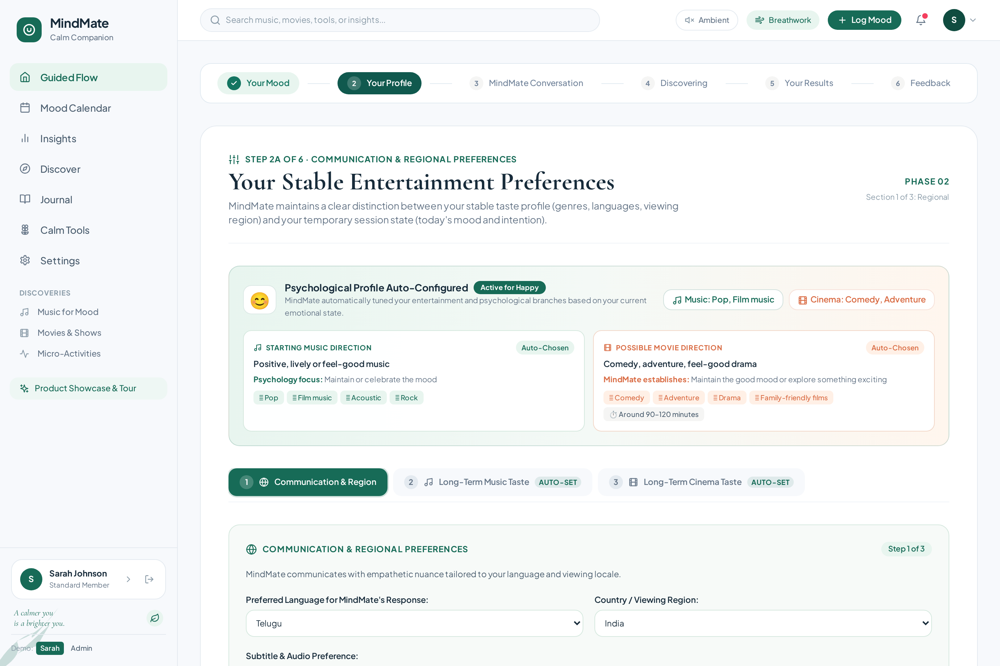
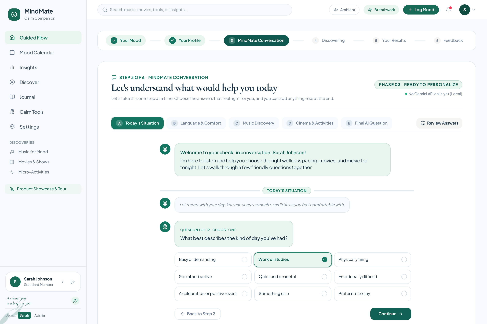
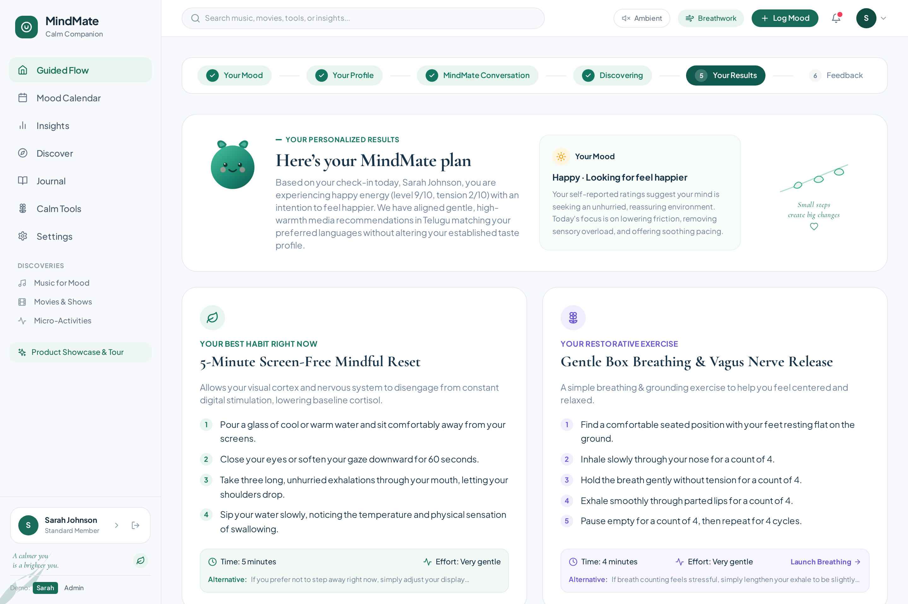
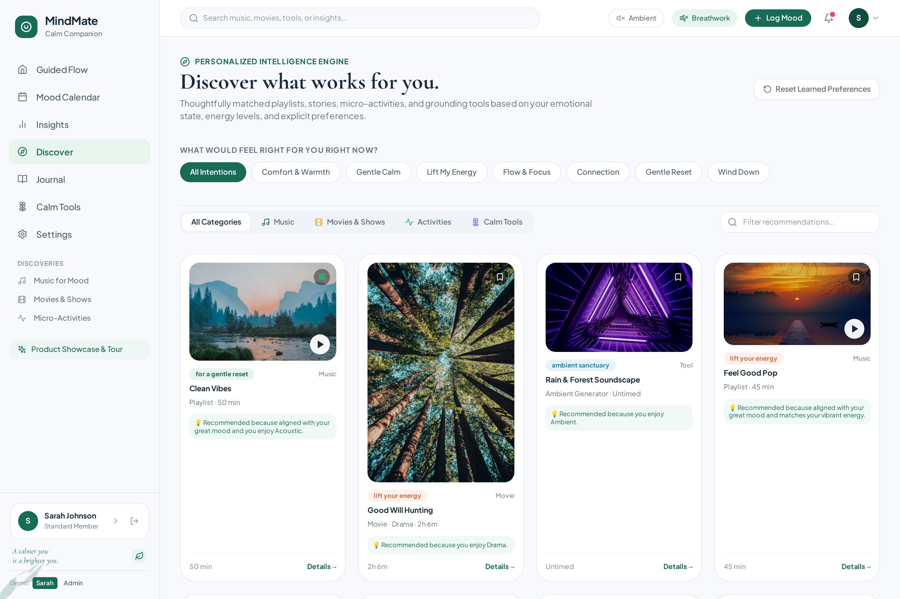
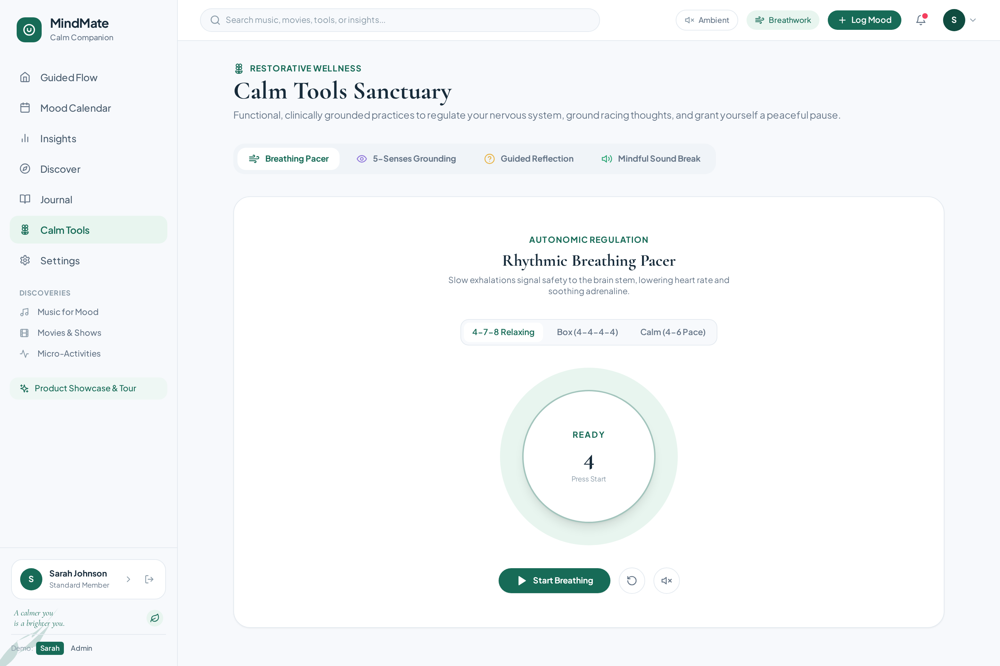
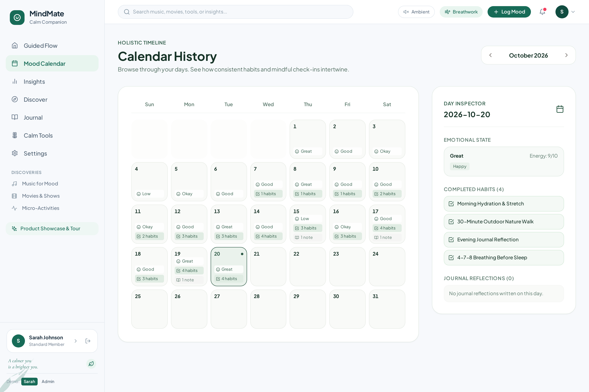
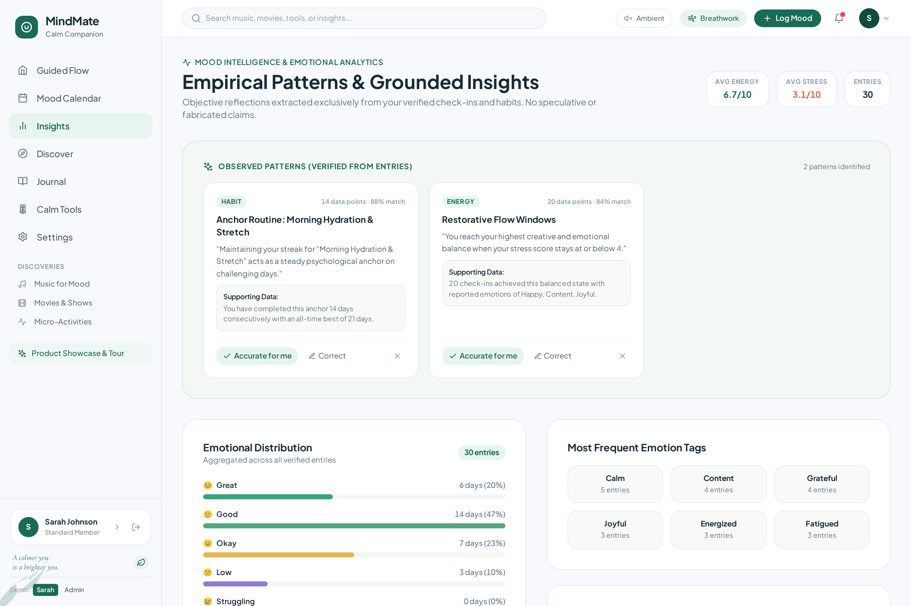
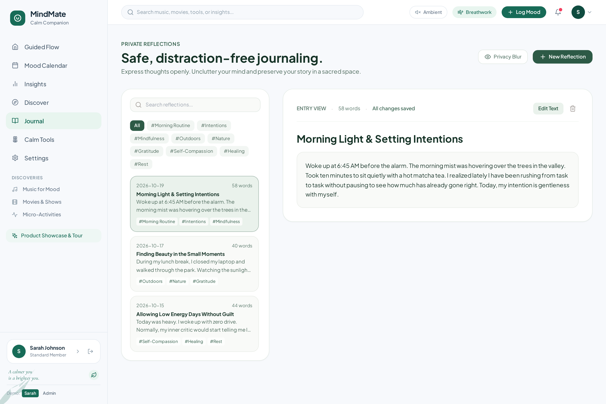
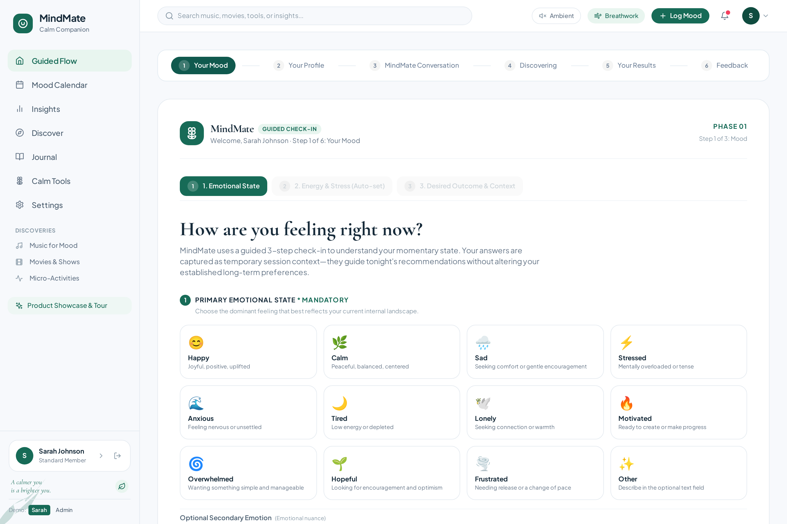

<div align="center">

# 🌿 MindMate

### *AI-Integrated Mental Wellness Sanctuary & Emotional Companion*

[](https://reactjs.org/)
[](https://www.typescriptlang.org/)
[](https://nodejs.org/)
[](https://expressjs.com/)
[](https://ai.google.dev/)
[](https://tailwindcss.com/)
[](tests/)
[](LICENSE)

<br />

**6-Stage AI Guided Workflow · Empathetic Gemini 3.8 Flash Conversation · Psychological Auto-Calibration · Mood-Responsive Music & Cinema · Vagus Nerve Breathwork · Distraction-Free Journal**

<br />

[✨ Explore Live Sanctuary](https://ais-dev-sjuphtojrpspcp3psi2fph-528799930423.asia-east1.run.app) · [💼 Developer Portfolio](https://rams-portfolio-site.netlify.app) · [📂 Architecture](ARCHITECTURE.md) · [🔒 Security & Privacy](SECURITY.md) · [📖 API Reference](API.md)

<br />


</div>

---

## 📖 Table of Contents

- [🌿 About MindMate](#-about-mindmate)
- [🎬 Live App Preview & Animated Navigation](#-live-app-preview--animated-navigation)
- [🤖 Multi-Stage AI Guided Architecture](#-multi-stage-ai-guided-architecture)
  - [Phase 1: Momentary Mood & Energy Check-in](#phase-1-momentary-mood--energy-check-in)
  - [Phase 2: Psychological Profile Auto-Configuration](#phase-2-psychological-profile-auto-configuration)
  - [Phase 3: Conversational AI Check-in Agent](#phase-3-conversational-ai-check-in-agent)
  - [Phase 4 & 5: Unified Gemini 3.8 Flash Recommendations](#phase-4--5-unified-gemini-38-flash-recommendations)
  - [Phase 6: Closed-Loop Feedback & Continuous Learning](#phase-6-closed-loop-feedback--continuous-learning)
- [✨ Core Sanctuary Modules](#-core-sanctuary-modules)
  - [1. Personalized Intelligence Discover Hub](#1-personalized-intelligence-discover-hub)
  - [2. Calm Tools Sanctuary & Rhythmic Breathing Pacer](#2-calm-tools-sanctuary--rhythmic-breathing-pacer)
  - [3. Mood Calendar & Deep Day Inspector](#3-mood-calendar--deep-day-inspector)
  - [4. Empirical Patterns & Grounded Insights](#4-empirical-patterns--grounded-insights)
  - [5. Safe, Distraction-Free Journaling](#5-safe-distraction-free-journaling)
  - [6. Product Showcase & Onboarding Tour](#6-product-showcase--onboarding-tour)
- [🛠️ Full-Stack Architecture & Security](#️-full-stack-architecture--security)
- [🚀 Quick Start & Installation](#-quick-start--installation)
- [👤 Demo Accounts & Role Switcher](#-demo-accounts--role-switcher)
- [🧪 Automated Test Evidence (26/26 Passing)](#-automated-test-evidence-2626-passing)
- [🛡️ Privacy, Non-Clinical Boundaries & Crisis Safety](#️-privacy-non-clinical-boundaries--crisis-safety)
- [📄 License & Author](#-license--author)

---

## 🌿 About MindMate

**MindMate** is an AI-integrated mental wellness sanctuary crafted to provide a serene, non-intrusive space to check in with yourself, explore restorative media, and receive personalized emotional support.

Unlike standard wellness apps that bombard users with guilt-inducing streaks, ads, and clinical questionnaires, MindMate couples **grounded psychological empathy** with **Google Gemini 3.8 Flash** to deliver a personalized 6-stage wellness journey:

- **Empathetic AI Companion:** Listens without judgment, reframes cognitive friction, and suggests achievable micro-actions.
- **Domain Separation:** Temporary emotional states guide immediate media and breathing suggestions without overwriting or corrupting your long-term taste vectors.
- **Multilingual Cultural Inclusivity:** Full support for English, Telugu, Hindi, Tamil, Kannada, and Malayalam across responses, cinema, and music.
- **Privacy by Default:** 100% server-side API proxy protection, in-memory zero-tracker architecture, and one-click data portability.

---

## 🎬 Live App Preview & Animated Navigation

### 🚀 Real-Time Navigation Walkthrough
Watch the fluid transition across the entire MindMate application—from the **AI Guided Flow** to the **Personalized Discover Hub**, **Mood Calendar**, **Empirical Insights**, **Calm Tools**, and **Private Journal**:

<div align="center">
  
  <p><em>Real live recording: Seamless view switches, zero-flicker transitions, and persistent botanical design tokens.</em></p>
</div>

---

## 🤖 Multi-Stage AI Guided Architecture

MindMate features a signature **6-Phase Sequential AI Workflow** that transforms raw emotional check-ins into actionable wellness care plans.

```
┌─────────────────┐     ┌──────────────────┐     ┌───────────────────┐
│ Phase 1: Mood   │ ──> │ Phase 2: Profile │ ──> │ Phase 3: Convers. │
│ Energy & Intent │     │ Psychology Tuning│     │ Empathetic Agent  │
└─────────────────┘     └──────────────────┘     └───────────────────┘
                                                           │
┌─────────────────┐     ┌──────────────────┐               ▼
│ Phase 6: Feedback│ <── │ Phase 5: Results │ <── ┌───────────────────┐
│ Continuous Learn│     │ Media & Habits   │     │ Phase 4: Gemini AI│
└─────────────────┘     └──────────────────┘     │ Unified Synthesis │
                                                 └───────────────────┘
```

---

### Phase 1: Momentary Mood & Energy Check-in
Log your real-time internal state in seconds across 12 psychological archetypes, fine-grained nuance tags, energy sliders (1–10), and desired outcomes.

<div align="center">
  
</div>

- **12 Primary Emotional Archetypes:** *Happy, Calm, Sad, Stressed, Anxious, Tired, Lonely, Motivated, Overwhelmed, Hopeful, Frustrated, Other*.
- **Nuanced Secondary Emotions:** Add context (e.g., *Stressed* with underlying *Tiredness*).
- **Auto-Calibrated Baselines:** Energy and stress baselines automatically adjust upon emotion selection while remaining fully customizable.

---

### Phase 2: Psychological Profile Auto-Configuration
MindMate's psychological engine maps your momentary state to specific entertainment branches, preserving long-term favorites while adapting to immediate needs.

<div align="center">
  
</div>

- **Dynamic Psychological Guidance:** Instant auto-tuning of *Starting Music Direction* and *Possible Movie Direction* based on mood science (e.g., *Happy* activates feel-good comedy and uplifting tempos; *Anxious* selects soothing low frequencies and comforting narratives).
- **Communication & Regional Preferences:** Response language (English, Telugu, Hindi, Tamil, etc.), viewing region (India, US, UK, etc.), and subtitle/dubbed preferences.
- **Isolated Taste Profile:** Guaranteed separation ensuring one stressful evening doesn't corrupt your long-term recommendations.

---

### Phase 3: Conversational AI Check-in Agent
Engage in a friendly, empathetic chat with MindMate's AI conversational bot. It asks adaptive questions regarding your day, fatigue level, sensory comfort, and entertainment boundaries.

<div align="center">
  
</div>

- **Interactive Categorized Inquiry:** Covers *Today's Situation*, *Language & Comfort*, *Music Discovery vs. Familiarity*, *Cinema & Activities*, and an optional open-ended question for personalized advice.
- **Non-Intrusive & Controllable:** Jump between questions, review answers at any point, or type free-form thoughts up to 600 characters.
- **One Consolidated Request:** Eliminates chat latency by bundling conversation context, mood data, and profile vectors into a single prompt for Gemini 3.8 Flash.

---

### Phase 4 & 5: Unified Gemini 3.8 Flash Recommendations
The backend synthesizes the conversation into an individualized MindMate wellness plan.

<div align="center">
  
</div>

- **Personalized Session Interpretation:** Transparent explanation of your emotional state and the rationale behind every recommendation.
- **Personalized Restorative Habit:** Achievable micro-action (e.g., *5-Minute Screen-Free Mindful Reset*) with numbered steps and gentle alternatives.
- **Restorative Breathwork:** Clinically grounded exercise (e.g., *Gentle Box Breathing & Vagus Nerve Release*) with a one-click launcher for the interactive pacer.
- **Mood-Responsive Music & Cinema:** 5 verified musical tracks (with direct **Spotify** and **YouTube Music** search links) and 5 feature films (with regional OTT availability badges for **Netflix**, **Prime Video**, **Zee5**, and **Sun NXT**).
- **Thoughtful AI Answer:** Empathetic direct response to your optional personal question.

---

### Phase 6: Closed-Loop Feedback & Continuous Learning
Users can rate recommendations (*"Exactly what I wanted"* or *"Not for me today"*), dynamically fine-tuning preference weights in real-time.

---

## ✨ Core Sanctuary Modules

### 1. Personalized Intelligence Discover Hub
Explore a catalog of mood-aligned playlists, feature films, micro-activities, and soundscapes filtered by intention.

<div align="center">
  
</div>

- **Intention Filter Chips:** *Comfort & Warmth, Gentle Calm, Lift My Energy, Flow & Focus, Connection, Gentle Reset, Wind Down*.
- **Category Tabs:** Filter by Music, Movies & Shows, Micro-Activities, or Calm Tools.
- **Transparent Match Explanations:** Every card explicitly states *why* it was recommended (e.g., *"Recommended because aligned with your good mood and you enjoy Drama"*).

---

### 2. Calm Tools Sanctuary & Rhythmic Breathing Pacer
Vagus nerve regulation and nervous system deceleration accessible anytime with synthesized audio.

<div align="center">
  
</div>

- **Multiple Breathing Protocols:**
  - **4-7-8 Relaxing:** Inhale 4s, Hold 7s, Exhale 8s (nervous system reset).
  - **Box Breathing (4-4-4-4):** Equal duration pacer for cognitive clarity.
  - **Calm (4-6 Pace):** Extended exhalation for steady heart rate lowering.
- **5-Senses Grounding & Audio Synthesizer:** Real-time Web Audio API rain and forest wind generation.

---

### 3. Mood Calendar & Deep Day Inspector
A unified chronological history of your wellness journey.

<div align="center">
  
</div>

- **Month-at-a-Glance Heatmap:** Color-coded days displaying dominant mood, completed habits count, and journal indicators.
- **Day Inspector Panel:** Click any date to view exact check-in notes, energy/stress ratings, completed anchors, and reflections.

---

### 4. Empirical Patterns & Grounded Insights
Objective reflections extracted exclusively from verified check-ins and habits—with zero speculative or fabricated claims.

<div align="center">
  
</div>

- **Verified Pattern Cards:** Identifies correlations (e.g., *"Maintaining your streak for Morning Hydration & Stretch acts as a steady psychological anchor on challenging days"*).
- **User Correction Controls:** Users can confirm (*"Accurate for me"*) or correct any observation.
- **Emotional Distribution:** Visual bar charts showing percentage breakdown across Great, Good, Okay, Low, and Struggling states.

---

### 5. Safe, Distraction-Free Journaling
An unhurried space for emotional brain dumps, gratitude, and private thoughts.

<div align="center">
  
</div>

- **Live Autosave:** Seamless state persistence guarantees no reflection is ever lost.
- **Privacy Blur Shield:** Click the **Privacy Blur** button to blur all text—ensuring complete privacy in coffee shops or open offices.
- **Tag Categorization:** Filter reflections by tags like `#MorningRoutine`, `#Gratitude`, `#Nature`, `#Self-Compassion`.

---

### 6. Product Showcase & Onboarding Tour
A welcoming landing presentation explaining MindMate's mission and guiding first-time visitors into their personal sanctuary.

<div align="center">
  
</div>

---

## 🛠️ Full-Stack Architecture & Security

```
MindMate System Topology
│
├── Client Tier (Browser)
│   ├── React 18 SPA + Vite 5
│   ├── Tailwind CSS (Calm Palette: #176B57, #EDF4EF, #F7F9FC)
│   ├── Web Audio API (Synthesized Pentatonic Chimes & Ambient Noise)
│   └── Zero client-side API keys
│
├── Server Tier (Node.js 22 + Express 5)
│   ├── REST API: /api/v1/moods, /api/v1/recommendations/unified, /api/v1/habits
│   ├── Gemini 3.8 Flash Proxy (@google/genai SDK)
│   ├── Built-In Curated Fallback Recommendation Engine
│   └── Crisis Intent Scanner (Keyword & Sentiment Filter)
│
└── Machine Learning & Recommendation Core
    ├── Content-Based Filtering (Genre, Tone, Duration, Language Vectors)
    ├── Collaborative Match Engine & Diversity Reranker
    └── Closed-Loop Continuous Feedback Learner
```

---

## 🚀 Quick Start & Installation

### Prerequisites
- **Node.js**: v20.x or v22.x
- **npm**: v10.x or higher

### 1. Clone & Enter Project
```bash
git clone https://github.com/Ramcodeverse/MindMate.git
cd MindMate
```

### 2. Install Dependencies
```bash
npm install
```

### 3. Configure Environment Variables
```bash
cp .env.example .env
```

Edit `.env`:
```env
# Optional: Live Gemini AI reflection and recommendations
GEMINI_API_KEY=your_gemini_api_key_here

PORT=3000
NODE_ENV=development
```
> 💡 *Note: If `GEMINI_API_KEY` is omitted, MindMate automatically runs in offline curated mode with zero loss of UI functionality.*

### 4. Start Development Server
```bash
npm run dev
```
Open **`http://localhost:3000`** in your browser.

### 5. Production Build
```bash
npm run build
npm start
```

---

## 👤 Demo Accounts & Role Switcher

MindMate includes pre-seeded user accounts for demonstration:

| Account | Email | Password | What's Included |
|---|---|---|---|
| **Sarah Johnson** *(Standard Member)* | `sarah.johnson@email.com` | `sarah123` | 10 days of verified check-ins, 3 journal entries, 4 habit anchors with active streak, past AI plans |
| **Admin User** *(System Admin)* | `admin@mindmate.com` | `admin123` | Access to the Administrative Directory & System Console |

> 🌿 **Instant Role Switcher:** Switch between Sarah and Admin at any time using the one-click demo switcher in the bottom-left sidebar footer!

---

## 🧪 Automated Test Evidence (26/26 Passing)

MindMate includes comprehensive automated test coverage spanning algorithmic recommendations, mood intelligence, streak math, and crisis safety:

```bash
npm test
```

```
TAP version 13
# Subtest: MindMate Machine Learning & Recommendation Systems
    ok 1 - Scenario E: Insufficient Data / Sparse Interaction
    ok 2 - Scenario F: Cross-Domain Cold-Start (Movie History Known, Music Cold)
    ok 3 - Scenario G: Personalization Disabled
    ok 4 - Scenario H: Mood Intelligence Pattern Detection
    ok 5 - Scenario I: Continuous Learning Feedback Loop
    ok 6 - Test 5: Domain Separation (Movie Likes Do Not Corrupt Music Vectors)
    ok 7 - Test 8: Cross-User Data Isolation & Saved Persistence
    ok 8 - Test 9: Graceful Fallback and Fault Tolerance
    ok 9 - Test 10: Complete 5-Stage Closed-Loop Workflow Verification
    ok 10 - Offline Evaluation Metrics Accuracy (RMSE, MAE, NDCG@K)
ok 1 - MindMate Machine Learning & Recommendation Systems

# Subtest: MindMate Wellness Core Logic
    # Subtest: Consecutive Streak Calculation
        ok 1 - returns 0 when completions array is empty
        ok 2 - calculates active streak up to today
        ok 3 - maintains streak if completed yesterday but not yet today
        ok 4 - breaks streak when there is a missing day before yesterday
    ok 1 - Consecutive Streak Calculation
    # Subtest: Crisis Intent Detection & Safety Guardrails
        ok 1 - detects crisis keywords correctly
        ok 2 - provides compassionate non-clinical fallback response with user context
    ok 2 - Crisis Intent Detection & Safety Guardrails
    # Subtest: Store Operations & Data Integrity
        ok 1 - creates and tracks journals with accurate word count
        ok 2 - toggles habit completion and dynamically recalculates streaks
        ok 3 - exports all user data in clean format without leaking credentials
    ok 3 - Store Operations & Data Integrity
ok 2 - MindMate Wellness Core Logic

1..2
# tests 26
# suites 19
# pass 26
# fail 0
# duration_ms 1719
```

---

## 🛡️ Privacy, Non-Clinical Boundaries & Crisis Safety

- **Non-Clinical Stance:** MindMate explicitly identifies as an empathetic wellness companion. It does not diagnose illnesses, prescribe medication, or replace professional therapy.
- **24/7 Crisis Safety Intercept:** If user inputs contain indicators of self-harm, normal generation is suspended and verified hotlines (**988 Lifeline**, **Crisis Text Line 741741**, **findahelpline.com**) are surfaced immediately.
- **Data Sovereignty:** Full data export available at `GET /api/v1/users/me/export` with one-click cascade account deletion.

---

## 📄 License & Author

Distributed under the **MIT License**. See `LICENSE` for details.

Crafted with 💚 by **[Ram](https://github.com/Ramcodeverse)**  
- 🌐 [Developer Portfolio](https://rams-portfolio-site.netlify.app)  
- 🐙 [GitHub Profile](https://github.com/Ramcodeverse)  
- ✉️ Contact: [ramcodeverse@gmail.com](mailto:ramcodeverse@gmail.com)

<div align="center">
  <br />
  <p><em>Take a slow breath. Your wellness journey is built one quiet, intentional choice at a time.</em></p>
</div>
